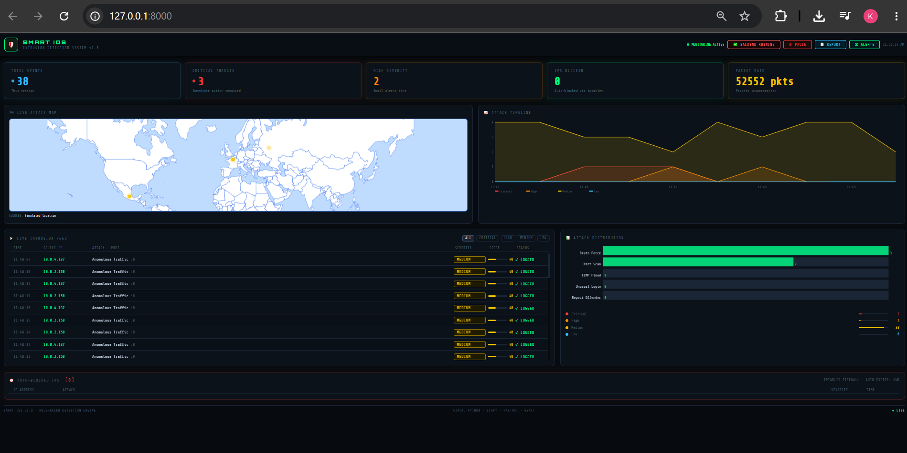

# Smart IDS


A network intrusion detection system in Python. It watches packets, flags suspicious behaviour with
**explainable rules** and an **Isolation Forest** anomaly model, shows alerts on a live web dashboard,
and can optionally block attackers with firewall rules.



## How it works

```
packets -> Pkt records -+-> RuleDetector -------------+
                        |                             +-> alerts -> dashboard / PDF report
                        +-> Isolation Forest windows -+        \-> firewall block (opt-in)
```

| Detector | Fires when |
|---|---|
| Rule: SSH Brute Force | one IP sends 6+ SYNs to port 22 within 60 s |
| Rule: Port Scan | one IP sends SYNs to 15+ different ports within 30 s |
| Rule: ICMP Flood | one IP sends 100+ ICMP packets within 10 s |
| Isolation Forest | a 10-second window of one IP's traffic looks unlike normal traffic (8 features: packets, SYNs, distinct ports and hosts, ICMP and UDP counts, mean size, SYN ratio) |

Detection logic never touches Scapy directly, so it is unit-tested and evaluated on recorded traffic.

## Results

Measured by `evaluate.py` on generated, labeled **synthetic** traffic: 317k packets, 80 attack episodes,
4,970 benign source-windows. Attacks include slow and weak variants plus a SYN flood that no rule covers.

| Detector | Attacks caught | Precision | F1 | False alarms |
|---|---|---|---|---|
| Rules only | 56% | 100% | 0.72 | 0 |
| Isolation Forest only | 71% | 91% | 0.80 | 24 |
| Rules + Isolation Forest | 91% | 93% | 0.92 | 24 |

The rules caught none of the SYN floods; the Isolation Forest caught all of them. Per-attack breakdown: `smart_ids/results.md`.

## Quick start

```bash
pip install -r smart_ids/requirements.txt
python -m smart_ids.run                          # replay demo: synthetic traffic, no admin needed
python -m smart_ids.run --mode live              # real capture (admin + Npcap on Windows, root on Linux)
python -m smart_ids.run --mode live --enforce    # also add real firewall block rules
python -m smart_ids.evaluate                     # re-measure the detectors
python -m pytest smart_ids/tests                 # 13 tests
```

Run all commands from the folder that contains `smart_ids/`.

## Safety by design

- Blocking is **dry-run by default**; `--enforce` is required to add firewall rules.
- Only public IPs can be blocked, never private, loopback or documentation ranges.
- IPs are validated and passed to the firewall as arguments (no shell).
- The server listens on 127.0.0.1 only.

## Scope and next steps

**Evaluation.** Results are measured on synthetic traffic, so they show behaviour on known attack shapes,
not real-world accuracy. Next: evaluate on CIC-IDS2017.

**Detection coverage.** Three rules plus an Isolation Forest for unseen patterns. Payload-level attacks
(DNS tunneling, C2 beaconing) are out of scope for now.

**Deployment.** Live capture is implemented and its packet parsing is unit-tested. The model is trained
on synthetic normal traffic and should be retrained on the target network's own traffic.

## Project layout

| File | Purpose |
|---|---|
| `packets.py` | packet record shared by all components |
| `detector.py` | rule-based detection with time windows and cooldowns |
| `ml.py` | Isolation Forest features, training, streaming scoring |
| `netcapture.py` | Scapy adapter for live capture |
| `responder.py` | safe firewall blocking |
| `server.py` | FastAPI backend and PDF report |
| `traffic_sim.py`, `evaluate.py` | synthetic labeled traffic and measurement |
| `dashboard.html` | web UI |

## License

MIT
